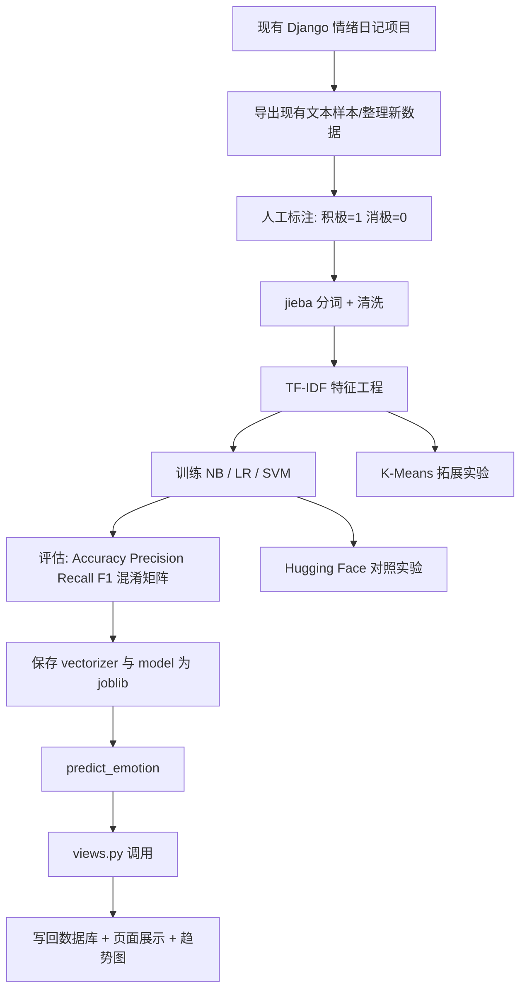

# Django 情绪日记项目升级为本地传统机器学习二分类系统的分阶段研究与实施方案

**Executive Summary：**  
对你当前项目而言，最稳妥、投入产出比最高的路线，不是重写整个网站，而是**保留现有 Django 交互层与数据库层，只替换“情绪识别内核”**：把原先依赖 Hugging Face API 的在线推理，改成**本地 `jieba` 分词 + `TfidfVectorizer` 特征提取 + `MultinomialNB / LogisticRegression / LinearSVC` 分类 + `joblib` 持久化 + `views.py` 调用 `predict_emotion()`**。这条路线与 scikit-learn 官方对文本特征提取、文本分类、混淆矩阵与 F1 评估、模型持久化的工具链完全匹配，也与 Django 的 `HttpRequest -> view -> HttpResponse` 工作方式天然兼容；原先的 Hugging Face 推理逻辑则最适合作为**对照实验**而不是主系统依赖。citeturn21view0turn19view3turn19view0turn19view2turn20view2turn20view1turn9view0turn22view0turn11view0

从环境选择上看，面向 2026 年 4 月的当前发行状态，Django 的最新 PyPI 主线已经是 6.0.4，但该版本要求 Python `>=3.12`；Django 5.2 文档支持 Python `3.10–3.14`，而 scikit-learn 1.8.0 的 PyPI 包要求 Python `>=3.11`。因此，如果你想兼顾“旧项目可迁移”“新机器学习栈稳定”“作业环境容易复现”，**统一到 Python 3.11 是最稳的折中方案**。与之匹配的可用版本可以锁为：Django 5.2.x、scikit-learn 1.8.0、jieba 0.42.1、joblib 1.5.3、pandas 3.0.2、matplotlib 3.10.9；若做 Hugging Face 对照实验，则 Transformers 当前 PyPI 最新为 5.6.2，PyTorch 当前 PyPI 最新为 2.11.0。citeturn27view0turn8view0turn28view0turn23search1turn23search2turn2search1turn1search3turn25search0turn24search0

下面这份方案按你需要的 **八个阶段**组织，每个阶段都给出目标、输入输出、可执行任务、脚本接口、关键代码、产出、调试建议、时间估计，以及答辩时适合展示的截图与图表。



## 立项与环境定版

**目标、输入/输出、时间估计**

| 项目 | 内容 |
|---|---|
| 目标 | 固定技术路线，定版环境，约束接口，避免做到一半反复返工 |
| 输入 | 你现有的 Django 项目、原 Hugging Face 调用代码、课程知识点 |
| 输出 | 统一目录结构、依赖版本、函数接口规范、标签定义规范 |
| 建议时长 | 4–8 小时，通常半天可完成 |

**本阶段重点依赖与版本建议**  
建议你先把“网站框架升级”和“机器学习升级”分离看待：**不必为了这次作业强行追到 Django 最新 6.0.4**。如果原项目已经能稳定运行，课堂项目更适合锁 **Python 3.11 + Django 5.2.x**；这既满足 Django 5.2 的官方支持范围，也满足 scikit-learn 1.8.0 的 Python 要求。与主线兼容的实用依赖建议如下：`django==5.2.*`、`scikit-learn==1.8.0`、`jieba==0.42.1`、`joblib==1.5.3`、`pandas==3.0.2`、`matplotlib==3.10.9`。如果你做对照实验，再额外安装 `transformers==5.6.2` 与 `torch==2.11.0`。citeturn27view0turn8view0turn28view0turn29view0turn23search2turn2search1turn1search3turn25search0turn24search0

**推荐目录结构表**

| 路径 | 作用 |
|---|---|
| `manage.py` | Django 启动入口 |
| `requirements.txt` | 固定依赖版本 |
| `config/settings.py` | Django 配置 |
| `app_diary/models.py` | 日记与情绪记录模型 |
| `app_diary/views.py` | 页面请求处理、调用 `predict_emotion()` |
| `app_diary/urls.py` | 路由 |
| `templates/` | 原页面模板复用 |
| `static/` | 静态资源 |
| `ml/data/raw/emotion_raw.csv` | 原始文本数据 |
| `ml/data/processed/emotion_labeled.csv` | 清洗+标注后的训练数据 |
| `ml/data/processed/train.csv` | 训练集 |
| `ml/data/processed/valid.csv` | 验证集 |
| `ml/data/processed/test.csv` | 测试集 |
| `ml/dicts/user_dict.txt` | 自定义词典 |
| `ml/dicts/stopwords.txt` | 停用词表 |
| `ml/artifacts/tfidf_vectorizer.joblib` | TF-IDF 向量器 |
| `ml/artifacts/nb_model.joblib` | NB 模型 |
| `ml/artifacts/lr_model.joblib` | LR 模型 |
| `ml/artifacts/svm_model.joblib` | SVM 模型 |
| `ml/reports/model_compare.csv` | 模型对比结果 |
| `ml/reports/confusion_matrix_*.png` | 混淆矩阵图 |
| `ml/reports/f1_bar.png` | F1 柱状图 |
| `ml/preprocess.py` | 清洗与分词 |
| `ml/feature_engineering.py` | 特征工程 |
| `ml/train_model.py` | 训练脚本 |
| `ml/evaluate_model.py` | 评估脚本 |
| `ml/predict.py` | 本地预测接口 |
| `ml/hf_predict.py` | Hugging Face 对照实验接口 |
| `ml/kmeans_experiment.py` | K-Means 拓展实验 |
| `report/` | 课程报告、PPT、截图、图表 |

**每个脚本的接口说明表**

| 脚本 | 函数名 | 参数 | 返回值 | 说明 |
|---|---|---|---|---|
| `ml/preprocess.py` | `clean_text` | `text: str` | `str` | 去空白、统一符号、基础清洗 |
| `ml/preprocess.py` | `segment_text` | `text: str, use_user_dict: bool=True` | `str` | `jieba` 分词后返回空格拼接文本 |
| `ml/preprocess.py` | `load_stopwords` | `path: str` | `set[str]` | 读取停用词 |
| `ml/feature_engineering.py` | `build_vectorizer` | `max_features, ngram_range, min_df, max_df` | `TfidfVectorizer` | 构建 TF-IDF 向量器 |
| `ml/train_model.py` | `train_nb` | `X_train, y_train` | `MultinomialNB` | 训练朴素贝叶斯 |
| `ml/train_model.py` | `train_lr` | `X_train, y_train` | `LogisticRegression` | 训练逻辑回归 |
| `ml/train_model.py` | `train_svm` | `X_train, y_train` | `LinearSVC` | 训练线性 SVM |
| `ml/evaluate_model.py` | `evaluate_classifier` | `model, X_test, y_test, labels` | `dict` | 计算 Accuracy/Precision/Recall/F1 |
| `ml/evaluate_model.py` | `plot_confusion_matrix_figure` | `y_true, y_pred, labels, save_path` | `str` | 保存混淆矩阵图片路径 |
| `ml/predict.py` | `load_artifacts` | `vectorizer_path, model_path` | `tuple` | 加载模型与向量器 |
| `ml/predict.py` | `predict_emotion` | `text: str` | `dict` | 返回情绪标签、中文说明、建议话术 |
| `ml/hf_predict.py` | `hf_predict` | `text: str, model_name: str|None=None` | `dict` | 作为对照实验调用 Transformers / 原 API |
| `ml/kmeans_experiment.py` | `run_kmeans` | `X, n_clusters=2` | `tuple` | 返回聚类器与聚类标签 |
| `app_diary/views.py` | `analyze_emotion` | `request` | `HttpResponse` | 读取用户输入并写库、渲染页面 |

**可执行任务清单**

1. 备份当前 Django 项目，至少做一个 Git 标签，例如 `before-ml-upgrade`。  
2. 创建新虚拟环境并安装固定版本依赖。  
3. 在项目根目录下新增 `ml/` 目录，不要把训练脚本散落在 `views.py` 里。  
4. 定义统一标签规范：训练标签只用 `1=积极`、`0=消极`；页面趋势分值可单独映射为 `+1/-1`。  
5. 把原 Hugging Face 调用点先抽象成一个统一接口，例如 `analyze_text(text)`，后面再替换成 `predict_emotion(text)`。  
6. 写一个最小可跑通的 `requirements.txt`，优先保证 **本地命令行训练能跑**，再考虑网页接入。  

**关键代码片段示例**

```python
# requirements 建议配套的最小核心环境（示意）
# Python 3.11
django==5.2.*
scikit-learn==1.8.0
jieba==0.42.1
joblib==1.5.3
pandas==3.0.2
numpy==2.4.4
matplotlib==3.10.9
transformers==5.6.2
torch==2.11.0
```

```python
# ml/config.py
from pathlib import Path

BASE_DIR = Path(__file__).resolve().parent.parent

RAW_DATA_PATH = BASE_DIR / "ml" / "data" / "raw" / "emotion_raw.csv"
LABELED_DATA_PATH = BASE_DIR / "ml" / "data" / "processed" / "emotion_labeled.csv"

VECTORIZER_PATH = BASE_DIR / "ml" / "artifacts" / "tfidf_vectorizer.joblib"
NB_MODEL_PATH = BASE_DIR / "ml" / "artifacts" / "nb_model.joblib"
LR_MODEL_PATH = BASE_DIR / "ml" / "artifacts" / "lr_model.joblib"
SVM_MODEL_PATH = BASE_DIR / "ml" / "artifacts" / "svm_model.joblib"
```

**预期产出**  
这一阶段最好形成三样东西：一份固定目录结构、一份依赖锁定文件、一份接口总表。它们的价值不在“炫技”，而在于后面每个阶段都不会因为命名混乱和路径混乱而返工。

**常见问题与调试建议**  
最常见的问题不是算法，而是**环境漂移**。scikit-learn 官方明确建议使用隔离环境；Windows 上还可能出现路径过长导致安装失败，官方文档也给了排查方法。citeturn7view0

**答辩时可展示的要点与截图/图表建议**  
建议展示一张“旧系统架构 vs 新系统架构”对比图，再展示现在的项目目录树截图。老师通常会在这一页就判断你是不是“真正做了系统改造”而不是只换了一个 API 名字。

## 数据准备

**目标、输入/输出、时间估计**

| 项目 | 内容 |
|---|---|
| 目标 | 构造可靠的积极/消极二分类语料，避免标签噪声过大 |
| 输入 | 原日记文本、自己补充的校园场景文本、可公开使用的中文短文本 |
| 输出 | `emotion_labeled.csv`、数据划分文件、标注规范文档 |
| 建议时长 | 1–2 天 |

**阶段说明**  
这一阶段的关键不是“数据越大越好”，而是**标签一致、文本风格与你的系统场景一致**。你的系统是“情绪日记”，不是“电商评论通用分类器”，因此最重要的数据应该来自：你已有的测试日记、你自己扩写的校园生活表达、再加少量公开中文短文本作补充。训练/测试划分建议使用 `train_test_split(..., stratify=y)`，这样测试集能保持和原标签分布一致。scikit-learn 文档明确说明了 `stratify` 参数用于按类别分层切分。citeturn20view0

**建议的数据字段设计**

| 字段名 | 类型 | 含义 |
|---|---|---|
| `text` | str | 原始文本 |
| `label` | int | 1=积极，0=消极 |
| `source` | str | `diary / manual / public` |
| `split` | str | `train / valid / test` |
| `notes` | str | 模糊样本说明，可选 |

**可执行任务清单**

1. 先导出你历史项目里用于测试或展示的文本，单独放入 `emotion_raw.csv`。  
2. 制定一页标注规范，例如：  
   - 明显正向期待、满足、放松、成就感 → 积极  
   - 明显消极压力、沮丧、愤怒、无力感 → 消极  
   - 纯客观陈述、信息不足 → 暂不入训练集  
3. 保证二分类第一版数据**尽量平衡**，例如先做 500–1000 条积极、500–1000 条消极。  
4. 去重：同义改写过于接近的样本，不要同时放进训练集和测试集。  
5. 用脚本把数据切成 `train / valid / test`，常用比例可先设 `8:1:1`。  
6. 统计每个 split 的标签分布，做一张柱状图。  

**关键代码片段示例**

```python
# ml/split_dataset.py
import pandas as pd
from sklearn.model_selection import train_test_split

def split_dataset(input_path: str, train_path: str, valid_path: str, test_path: str):
    df = pd.read_csv(input_path).dropna(subset=["text", "label"]).drop_duplicates(subset=["text"])
    df["label"] = df["label"].astype(int)

    train_df, temp_df = train_test_split(
        df,
        test_size=0.2,
        random_state=42,
        stratify=df["label"]
    )

    valid_df, test_df = train_test_split(
        temp_df,
        test_size=0.5,
        random_state=42,
        stratify=temp_df["label"]
    )

    train_df.to_csv(train_path, index=False, encoding="utf-8-sig")
    valid_df.to_csv(valid_path, index=False, encoding="utf-8-sig")
    test_df.to_csv(test_path, index=False, encoding="utf-8-sig")

    return {
        "train": train_df.shape[0],
        "valid": valid_df.shape[0],
        "test": test_df.shape[0]
    }
```

**预期产出**

| 产出 | 说明 |
|---|---|
| `ml/data/processed/emotion_labeled.csv` | 干净标注数据 |
| `ml/data/processed/train.csv` | 训练集 |
| `ml/data/processed/valid.csv` | 验证集 |
| `ml/data/processed/test.csv` | 测试集 |
| `ml/reports/label_distribution.png` | 标签分布图 |
| `report/label_guide.md` | 标注规范 |

**常见问题与调试建议**  
最容易出错的地方有两个。第一，**把“中性文本”硬塞进积极/消极**，会直接拉低 F1；第二，**训练集和测试集中出现高度相似的重复句子**，会让结果虚高。处理办法很朴素：宁可少一点，也要把边界模糊样本先剔掉，把测试集留得更“干净”。

**答辩时可展示的要点与截图/图表建议**  
可以展示三张图：数据量统计表、标签分布柱状图、样例数据截图。答辩时要强调：**我不是直接拿网络大模型预测结果反向造标签，而是做了人工规则标注**。这句话很加分。

## 预处理与特征工程

**目标、输入/输出、时间估计**

| 项目 | 内容 |
|---|---|
| 目标 | 把中文日记文本转成可供传统机器学习使用的数值特征 |
| 输入 | `train/valid/test.csv`、停用词、用户词典 |
| 输出 | 分词后的文本、TF-IDF 向量器、词表统计 |
| 建议时长 | 6–12 小时 |

**阶段说明**  
中文短文本要先解决“分词”问题。`jieba` 官方 README 说明，**精确模式适合文本分析**，并且支持**自定义词典**；这对于“期末”“答辩”“DDL”“科研”“宿舍”“保研”等校园场景词很重要。scikit-learn 的 `TfidfVectorizer` 用于把原始文档转成 TF-IDF 特征矩阵；它支持 `tokenizer`、`ngram_range`、`max_df`、`min_df`、`max_features` 等关键参数，其中 `max_df`/`min_df` 用于过滤过高频或过低频词，`ngram_range=(1,2)` 可同时纳入 unigram 和 bigram。citeturn13view0turn21view0turn26view0turn21view2turn21view3

**本阶段推荐策略**  
对你的项目，第一版完全没必要做很重的 NLP。建议采用下面这条稳定路线：  
先做基础清洗，再用 `jieba.lcut()` 分词，然后把词列表用空格拼起来，最后把这些“空格分隔的中文 token 串”送入 `TfidfVectorizer(tokenizer=str.split, preprocessor=None, token_pattern=None)`。这样做的好处是：**分词逻辑完全可控，TF-IDF 仍然交给 scikit-learn 处理**。

**可执行任务清单**

1. 写 `clean_text()`：去两端空白、统一全角半角、替换连续空格、去掉极端噪声符号。  
2. 准备 `user_dict.txt`：把校园特殊词、人名、社团名、课程名加入词典。  
3. 使用 `jieba.load_userdict()` 装载自定义词典。  
4. 准备 `stopwords.txt`；第一版不必追求大而全，先包含最常见虚词与无意义口语词。  
5. 生成两列：`clean_text` 与 `seg_text`。  
6. 用 `TfidfVectorizer` 做两套特征配置：  
   - 基线：`ngram_range=(1,1)`  
   - 强一点：`ngram_range=(1,2)`  
7. 记录词表大小与稀疏度，写进报告。  

**关键代码片段示例**

```python
# ml/preprocess.py
import re
import jieba

def clean_text(text: str) -> str:
    text = str(text).strip()
    text = re.sub(r"\s+", " ", text)
    text = re.sub(r"[^\w\s\u4e00-\u9fff，。！？、；：“”‘’（）《》【】…—-]", "", text)
    return text

def load_user_dict(user_dict_path: str | None = None):
    if user_dict_path:
        jieba.load_userdict(user_dict_path)

def segment_text(text: str, stopwords: set[str] | None = None) -> str:
    text = clean_text(text)
    tokens = jieba.lcut(text, cut_all=False)
    if stopwords:
        tokens = [w for w in tokens if w.strip() and w not in stopwords]
    else:
        tokens = [w for w in tokens if w.strip()]
    return " ".join(tokens)
```

```python
# ml/feature_engineering.py
from sklearn.feature_extraction.text import TfidfVectorizer

def build_vectorizer(max_features=8000, ngram_range=(1, 2), min_df=2, max_df=0.9):
    return TfidfVectorizer(
        tokenizer=str.split,
        preprocessor=None,
        token_pattern=None,
        lowercase=False,
        max_features=max_features,
        ngram_range=ngram_range,
        min_df=min_df,
        max_df=max_df
    )
```

**预期产出**

| 产出 | 说明 |
|---|---|
| `ml/data/processed/train_segmented.csv` | 训练集分词结果 |
| `ml/data/processed/test_segmented.csv` | 测试集分词结果 |
| `ml/dicts/user_dict.txt` | 自定义词典 |
| `ml/dicts/stopwords.txt` | 停用词 |
| `ml/reports/vocab_stats.csv` | 词表大小、DF 统计 |
| `ml/artifacts/tfidf_vectorizer.joblib` | 训练后保存的向量器 |

**常见问题与调试建议**  
最常见的坑有四个。第一，自定义词典没生效，导致“机器学习”“答辩周”被切碎；第二，停用词删得太狠，把“开心”“难过”这种情绪核心词误删；第三，`min_df` 设太高，导致词表太小；第四，`max_features` 设太低，模型学不到足够信息。你可以先用一个小样本打印出“原句—分词结果—保留词”三连表，先看效果再大规模跑。

**答辩时可展示的要点与截图/图表建议**  
很推荐展示一页“原始文本 → 清洗后 → 分词后”的三列表，再配一张“词表大小 / 稀疏度 / 特征配置”的参数表。老师会很直观地看到你做了**特征工程**而不是把文本直接喂给黑盒。

## 监督模型训练

**目标、输入/输出、时间估计**

| 项目 | 内容 |
|---|---|
| 目标 | 训练并保存 NB、LR、SVM 三个传统分类模型 |
| 输入 | 训练集分词文本、TF-IDF 特征 |
| 输出 | 三个模型文件、训练日志、模型对比表 |
| 建议时长 | 6–10 小时 |

**阶段说明**  
你课程里学到的三类文本分类主力模型都适合在这里落地：  
`MultinomialNB` 官方文档明确写到，它适合离散特征的文本分类，虽然理论上更贴近词频计数，但**对 TF-IDF 这样的分数特征在实践中也常常可用**；`LogisticRegression` 支持稀疏输入，并且默认带正则化；`LinearSVC` 是线性核 SVM 的更快实现，支持稀疏输入，并且在高维文本空间里通常是很强的基线。对于你的作业，三者都应该训练，但**网页默认上线模型通常优先在 LR 与 LinearSVC 中择优**。citeturn19view3turn19view0turn19view1turn19view2

**模型配置建议**

| 模型 | 建议初始参数 | 说明 |
|---|---|---|
| NB | `MultinomialNB(alpha=1.0)` | 稳、快、易解释 |
| LR | `LogisticRegression(max_iter=1000, random_state=42)` | 稀疏特征友好，可输出较稳定结果 |
| SVM | `LinearSVC(random_state=42)` | 通常是文本任务强基线 |
| 可选扩展 | `class_weight="balanced"` | 若正负样本明显不平衡再考虑 |

**可执行任务清单**

1. 装载训练集与验证集。  
2. 对训练集 `fit_transform()` 得到 `X_train`；对验证/测试集只做 `transform()`。  
3. 分别训练 NB、LR、SVM。  
4. 在验证集上先评估，避免一上来盯着测试集反复调参。  
5. 把三种模型与同一个 TF-IDF 向量器分别保存。  
6. 输出每个模型的训练时间与验证集 F1。  
7. 选择一个主模型进入 Django 接入阶段。  

**关键代码片段示例**

```python
# ml/train_model.py
import time
import joblib
import pandas as pd
from sklearn.naive_bayes import MultinomialNB
from sklearn.linear_model import LogisticRegression
from sklearn.svm import LinearSVC

from ml.feature_engineering import build_vectorizer

def train_nb(X_train, y_train):
    model = MultinomialNB(alpha=1.0)
    model.fit(X_train, y_train)
    return model

def train_lr(X_train, y_train):
    model = LogisticRegression(max_iter=1000, random_state=42)
    model.fit(X_train, y_train)
    return model

def train_svm(X_train, y_train):
    model = LinearSVC(random_state=42)
    model.fit(X_train, y_train)
    return model

def train_all(train_csv, vectorizer_path, model_paths):
    df = pd.read_csv(train_csv)
    X_text = df["seg_text"].tolist()
    y = df["label"].astype(int).tolist()

    vectorizer = build_vectorizer()
    X_train = vectorizer.fit_transform(X_text)

    models = {
        "nb": train_nb,
        "lr": train_lr,
        "svm": train_svm,
    }

    trained = {}
    for name, fn in models.items():
        t0 = time.time()
        model = fn(X_train, y)
        trained[name] = {
            "model": model,
            "train_seconds": round(time.time() - t0, 4)
        }
        joblib.dump(model, model_paths[name])

    joblib.dump(vectorizer, vectorizer_path)
    return trained
```

**预期产出**

| 产出 | 说明 |
|---|---|
| `ml/artifacts/nb_model.joblib` | NB 模型 |
| `ml/artifacts/lr_model.joblib` | LR 模型 |
| `ml/artifacts/svm_model.joblib` | SVM 模型 |
| `ml/reports/train_log.json` | 训练耗时与参数日志 |
| `ml/reports/model_compare.csv` | 验证集比较表 |

**常见问题与调试建议**  
最常见的调试问题是 `LogisticRegression` 的收敛警告，这通常不是“模型坏了”，而是 `max_iter` 太小；文本稀疏特征很常见，把它提升到 1000 往往就够。另一个常见问题是**训练集用一个 vectorizer、测试预测时又重新 `fit` 了另一个 vectorizer**，这样维度会错位，预测结果会完全不可信。解决方法很简单：**vectorizer 与 model 必须成对保存、成对加载**。

**答辩时可展示的要点与截图/图表建议**  
这一页建议做成“同一数据、同一特征、三个模型横向对比”——最少展示 Accuracy 和 F1，最好再展示训练时长。你要强调的是：**我没有只做一个模型，而是做了模型比较和选择**。

## 评估与误差分析

**目标、输入/输出、时间估计**

| 项目 | 内容 |
|---|---|
| 目标 | 用课程要求的评估指标证明模型有效，并分析错误样本 |
| 输入 | 测试集、三种模型预测结果 |
| 输出 | 混淆矩阵图、分类报告、F1 对比图、误分类案例表 |
| 建议时长 | 6–12 小时 |

**阶段说明**  
F1 是你这类二分类项目最值得强调的指标之一。scikit-learn 官方把 F1 定义为 Precision 与 Recall 的调和平均数，范围在 0 到 1 之间；`confusion_matrix` 的定义则是：矩阵中第 `i, j` 项表示“真实类别为 i、预测为 j”的样本数量。`classification_report` 还会给出 `macro avg` 和 `weighted avg`：前者是不考虑类别占比的简单平均，后者按各类别样本数加权平均。对于课堂报告，**至少给出 Accuracy、积极类 Precision/Recall/F1、Macro F1、Weighted F1、混淆矩阵**。citeturn20view1turn20view2turn18view1turn20view3

**可执行任务清单**

1. 对每个模型在测试集上生成 `y_pred`。  
2. 输出 `classification_report(output_dict=True)`。  
3. 计算 Accuracy、积极类 F1、Macro F1、Weighted F1。  
4. 为 NB/LR/SVM 各保存一张混淆矩阵图。  
5. 抽取误分类样本，按“假阳性/假阴性”分类整理。  
6. 分析错误原因，例如：  
   - 反讽  
   - 多情绪混杂  
   - 分词失败  
   - 数据标签本身模糊  

**关键代码片段示例**

```python
# ml/evaluate_model.py
import pandas as pd
from sklearn.metrics import (
    accuracy_score,
    f1_score,
    confusion_matrix,
    classification_report,
    ConfusionMatrixDisplay
)
import matplotlib.pyplot as plt

def evaluate_classifier(model, X_test, y_test, labels=(0, 1)):
    y_pred = model.predict(X_test)

    metrics = {
        "accuracy": accuracy_score(y_test, y_pred),
        "f1_positive": f1_score(y_test, y_pred, pos_label=1, average="binary"),
        "f1_macro": f1_score(y_test, y_pred, average="macro"),
        "f1_weighted": f1_score(y_test, y_pred, average="weighted"),
        "report": classification_report(y_test, y_pred, output_dict=True, zero_division=0),
        "confusion_matrix": confusion_matrix(y_test, y_pred, labels=list(labels)).tolist(),
        "y_pred": y_pred
    }
    return metrics

def plot_confusion_matrix_figure(y_true, y_pred, save_path, labels=("消极", "积极")):
    fig, ax = plt.subplots(figsize=(4, 4))
    disp = ConfusionMatrixDisplay.from_predictions(
        y_true, y_pred, display_labels=list(labels), ax=ax
    )
    fig.tight_layout()
    fig.savefig(save_path, dpi=200)
    plt.close(fig)
    return save_path
```

**示例实验结果表格模板（空表格）**

| 模型 | 特征配置 | Accuracy | 积极 Precision | 积极 Recall | 积极 F1 | Macro F1 | Weighted F1 | 训练时间（s） | 单条预测耗时（ms） | 备注 |
|---|---|---:|---:|---:|---:|---:|---:|---:|---:|---|
| NB | TF-IDF unigram |  |  |  |  |  |  |  |  |  |
| LR | TF-IDF unigram |  |  |  |  |  |  |  |  |  |
| SVM | TF-IDF unigram |  |  |  |  |  |  |  |  |  |
| NB | TF-IDF uni+bi |  |  |  |  |  |  |  |  |  |
| LR | TF-IDF uni+bi |  |  |  |  |  |  |  |  |  |
| SVM | TF-IDF uni+bi |  |  |  |  |  |  |  |  |  |
| Hugging Face 对照 | 固定 checkpoint |  |  |  |  |  |  |  |  |  |

**误差分析表模板（建议）**

| 文本 | 真实标签 | 预测标签 | 错误类型 | 可能原因 | 是否需要补词典/补样本 |
|---|---:|---:|---|---|---|
|  |  |  | 假阳性 / 假阴性 |  |  |

**预期产出**

| 产出 | 说明 |
|---|---|
| `ml/reports/model_compare.csv` | 模型指标总表 |
| `ml/reports/confusion_matrix_nb.png` | NB 混淆矩阵 |
| `ml/reports/confusion_matrix_lr.png` | LR 混淆矩阵 |
| `ml/reports/confusion_matrix_svm.png` | SVM 混淆矩阵 |
| `ml/reports/f1_bar.png` | F1 柱状图 |
| `ml/reports/error_cases.xlsx` | 误分类案例 |

**常见问题与调试建议**  
第一，别把正负标签写反；第二，二分类时 `pos_label=1` 要始终一致；第三，如果某个类别在预测里完全没出现，`classification_report` 会触发 zero-division 场景，这时要显式写 `zero_division=0`；第四，混淆矩阵行列顺序要在图注里写清楚，否则答辩老师会问“左上角这个 120 是什么”。这些都不是小问题，而是实验是否严谨的问题。citeturn20view1turn20view2turn18view1

**答辩时可展示的要点与截图/图表建议**  
强烈建议至少展示：  
一张模型 F1 柱状图；  
一张你最终主模型的混淆矩阵；  
一页误分类案例分析。  
其中误分类页最能体现你“真的懂模型”。很多答辩老师更看重“你能解释模型为什么错”，而不是单纯追求高分数。

## 对照实验与无监督拓展

**目标、输入/输出、时间估计**

| 项目 | 内容 |
|---|---|
| 目标 | 保留旧方案做对照，同时用 K-Means 做课程拓展 |
| 输入 | 测试集文本、主模型结果、HF 推理接口、TF-IDF 特征 |
| 输出 | 对照实验表、K-Means 聚类结果、拓展图表 |
| 建议时长 | 6–10 小时 |

**阶段说明**  
Hugging Face 官方文档明确说明，`pipeline()` 是一种非常方便的推理封装，`"text-classification"` 与 `"sentiment-analysis"` 都可直接用来做情绪分析；官方文本分类任务文档也把 sentiment analysis 作为最典型的文本分类应用之一。因此，你之前的系统非常适合被保留为**外部基线**：同一批样本上，比较“本地传统机器学习模型”与“预训练情绪模型/API”的 Accuracy、F1、单条耗时、是否依赖网络。这样做的价值不是证明谁更强，而是证明：**你这次作业实现了“从调用现成模型”到“自己训练本地模型”的升级**。citeturn11view0turn12view1turn12view0

如果你打算把无监督学习也写进作业，K-Means 是最自然的拓展。scikit-learn 文档指出，K-Means 速度很快，但会陷入局部最优；在稀疏高维文本上，初始化有时会很不稳定。官方文本聚类示例进一步说明，对 TF-IDF 文本先做 `TruncatedSVD + Normalizer` 的 LSA 降维，再跑 K-Means，通常会更稳定。对你的项目来说，**K-Means 不适合做主系统情绪判别**，但很适合作为“拓展实验”：看看文本能否自然聚成两团，并分析每团的高频词。citeturn5search2turn5search10turn17view1turn17view2

**可执行任务清单**

1. 复用你旧项目里的 HF 接口，封装 `hf_predict(text)`。  
2. 固定一个 checkpoint 或固定你原先的 API 配置，不要对照实验里不停换模型。  
3. 在同一测试集上比较：  
   - Accuracy  
   - 积极类 F1  
   - 平均单条预测耗时  
   - 是否依赖网络  
4. 做一个 30–100 条“真实日记样本”人工复核小表，作为补充对照。  
5. 用 TF-IDF 结果直接做 `KMeans(n_clusters=2)`。  
6. 再做一版 `LSA + KMeans` 作为更稳定的扩展。  
7. 用多数投票把 cluster id 映射到“偏积极/偏消极”，写明这是**后验解释**而不是监督训练。  

**关键代码片段示例**

```python
# ml/hf_predict.py
from transformers import pipeline

# 建议在对照实验里固定模型名；也可以先复用你原先的 API
classifier = pipeline("sentiment-analysis")

def hf_predict(text: str) -> dict:
    result = classifier(text)[0]
    label = result["label"].upper()
    score = float(result["score"])

    if "POS" in label:
        mapped = 1
        zh = "积极"
    else:
        mapped = 0
        zh = "消极"

    return {
        "label": mapped,
        "emotion": zh,
        "raw_label": label,
        "score": score
    }
```

```python
# ml/kmeans_experiment.py
from sklearn.cluster import KMeans
from sklearn.decomposition import TruncatedSVD
from sklearn.pipeline import make_pipeline
from sklearn.preprocessing import Normalizer

def run_kmeans_on_tfidf(X, n_clusters=2, random_state=42):
    model = KMeans(n_clusters=n_clusters, n_init=10, random_state=random_state)
    labels = model.fit_predict(X)
    return model, labels

def run_lsa_kmeans(X, n_clusters=2, n_components=100, random_state=42):
    lsa = make_pipeline(
        TruncatedSVD(n_components=n_components, random_state=random_state),
        Normalizer(copy=False)
    )
    X_lsa = lsa.fit_transform(X)
    model = KMeans(n_clusters=n_clusters, n_init=10, random_state=random_state)
    labels = model.fit_predict(X_lsa)
    return lsa, model, labels
```

**预期产出**

| 产出 | 说明 |
|---|---|
| `ml/reports/hf_compare.csv` | 本地模型 vs HF 对照结果 |
| `ml/reports/latency_compare.csv` | 单条耗时对比 |
| `ml/reports/kmeans_cluster_terms.csv` | 每个簇的高频词 |
| `ml/reports/kmeans_compare.csv` | TF-IDF KMeans vs LSA+KMeans 对比 |
| `ml/reports/kmeans_vis.png` | 可视化结果图 |

**常见问题与调试建议**  
Hugging Face 对照里最容易出错的是**标签映射不一致**。有的模型返回 `LABEL_0/LABEL_1`，有的返回 `POSITIVE/NEGATIVE`，你必须把最终映射规则写死，并记录在报告里。K-Means 的常见误区则是把 `cluster=0` 直接当成“消极”、`cluster=1` 直接当成“积极”——这在无监督学习里是没有保证的，必须通过簇内样本多数标签或高频词来做后验解释。

**答辩时可展示的要点与截图/图表建议**  
这一部分最适合做两页：  
第一页展示“本地模型 vs Hugging Face”的横向表格；  
第二页展示 “K-Means 聚类高频词 / LSA 后聚类可视化”。  
你要明确说：**Hugging Face 是对照基线，K-Means 是课程拓展，真正上线到 Django 系统的是监督学习主模型。**

## Django 集成与模型持久化

**目标、输入/输出、时间估计**

| 项目 | 内容 |
|---|---|
| 目标 | 把训练好的本地模型接入现有 Django 项目，替换原 API 调用 |
| 输入 | `joblib` 模型文件、向量器文件、现有页面与数据库模型 |
| 输出 | 本地预测接口、保存结果的视图、前端结果页 |
| 建议时长 | 1–2 天 |

**阶段说明**  
Django 官方文档对 view 的定义非常直接：view 是一个接收 web request 并返回 web response 的 Python 函数，通常就放在 `views.py`；每个 view 函数都接收 `HttpRequest` 作为第一个参数并返回 `HttpResponse`。对于表单提交，官方还特别提醒：不要用 `if request.POST` 来判断是否是 POST 请求，而应该用 `if request.method == "POST"`。这正好适配你的系统：前端提交日记文本，`views.py` 调用 `predict_emotion()`，再把结果写进数据库并渲染页面。citeturn10view1turn9view0

模型持久化方面，scikit-learn 官方的模型持久化文档和 joblib 文档都强调了两点：第一，`joblib` 适合保存和加载包含大数组的机器学习对象；第二，**加载 joblib / pickle 文件可能执行任意代码，因此只能加载你自己信任的模型文件**。与此同时，scikit-learn 也明确提示：训练环境与加载环境应尽量使用相同的包与版本，否则跨版本加载并不受支持。对你的项目，这意味着：**把 `vectorizer.joblib` 与 `svm_model.joblib` 一起保存、一起部署，并把依赖版本锁死在 `requirements.txt` 中。**citeturn14view0turn14view1turn22view0

**可执行任务清单**

1. 在 `ml/predict.py` 中实现全局加载与单函数预测接口。  
2. 在 Django 启动后尽量复用已加载模型，避免每次请求都重新 `joblib.load()`。  
3. 修改 `views.py`：  
   - 读取表单文本  
   - 调用 `predict_emotion(text)`  
   - 保存数据库  
   - 返回模板  
4. 如原有数据库没有数值标签字段，补一个 `emotion_label` 或 `score` 字段。  
5. 页面上显示“文本内容、预测情绪、所用模型、分析时间、建议语句”。  
6. 保留原 Hugging Face 入口但不要作为默认路径。  

**关键代码片段示例**

```python
# ml/predict.py
import joblib
from pathlib import Path
from ml.preprocess import segment_text

BASE_DIR = Path(__file__).resolve().parent.parent
VECTORIZER_PATH = BASE_DIR / "ml" / "artifacts" / "tfidf_vectorizer.joblib"
MODEL_PATH = BASE_DIR / "ml" / "artifacts" / "svm_model.joblib"

_vectorizer = joblib.load(VECTORIZER_PATH)
_model = joblib.load(MODEL_PATH)

def predict_emotion(text: str) -> dict:
    if not text or not str(text).strip():
        return {
            "label": None,
            "emotion": "未知",
            "message": "输入为空，无法分析。"
        }

    seg_text = segment_text(text)
    X = _vectorizer.transform([seg_text])
    pred = int(_model.predict(X)[0])

    if pred == 1:
        return {
            "label": 1,
            "emotion": "积极",
            "message": "整体情绪偏积极，可以继续保持当前节奏。"
        }
    return {
        "label": 0,
        "emotion": "消极",
        "message": "当前文本表现出较明显压力或负面情绪，建议适度休息。"
    }
```

```python
# app_diary/views.py
from django.shortcuts import render
from .models import MoodRecord
from ml.predict import predict_emotion

def analyze_emotion(request):
    if request.method == "POST":
        content = request.POST.get("content", "").strip()
        result = predict_emotion(content)

        if result["label"] is not None:
            MoodRecord.objects.create(
                content=content,
                emotion=result["emotion"],
                emotion_label=result["label"]
            )

        return render(
            request,
            "analysis_result.html",
            {
                "content": content,
                "emotion": result["emotion"],
                "message": result["message"],
                "model_name": "TF-IDF + LinearSVC"
            }
        )

    return render(request, "analyze.html")
```

```python
# app_diary/models.py
from django.db import models

class MoodRecord(models.Model):
    content = models.TextField()
    emotion = models.CharField(max_length=20)
    emotion_label = models.IntegerField(default=0)  # 训练标签: 1/0
    score = models.IntegerField(default=0)          # 页面走势: +1/-1，可选
    created_at = models.DateTimeField(auto_now_add=True)

    def save(self, *args, **kwargs):
        self.score = 1 if self.emotion_label == 1 else -1
        super().save(*args, **kwargs)
```

**预期产出**

| 产出 | 说明 |
|---|---|
| `ml/predict.py` | 本地推理接口 |
| `app_diary/views.py` | 已切换到本地模型的视图 |
| `app_diary/models.py` | 情绪数值字段更新 |
| `templates/analysis_result.html` | 更新后的结果页 |
| `db.sqlite3` / 业务数据库 | 可查询历史心情记录 |

**常见问题与调试建议**  
高频问题主要有五类：  
一是 `ModuleNotFoundError`，通常是 `ml/` 目录没被正确识别到 Python 路径；  
二是 `ValueError: X has n features...`，通常是加载了错误的 vectorizer；  
三是中文编码乱码，多半是 CSV 未统一到 UTF-8；  
四是每次请求都重新加载模型，页面明显变慢；  
五是**训练环境和部署环境版本不一致**，导致 joblib 文件加载失败。最后这一类要特别注意，scikit-learn 官方明确提示跨版本加载模型不受支持。citeturn22view0turn14view0

**答辩时可展示的要点与截图/图表建议**  
这一部分建议准备三张截图：  
输入页；  
结果页；  
数据库/后台记录页。  
如果你还能再加一张“旧版 API 调用 view 代码”与“新版本地模型 view 代码”的对比截图，答辩时说服力会非常强。

## 部署、报告与答辩

**目标、输入/输出、时间估计**

| 项目 | 内容 |
|---|---|
| 目标 | 让项目可复现、可演示、可答辩 |
| 输入 | 已集成的 Django 系统、实验图表、结果表 |
| 输出 | 可运行项目、报告、PPT、答辩演示材料 |
| 建议时长 | 1–2 天 |

**阶段说明**  
如果只是课堂本地演示，`runserver` 已经足够；但如果你要做部署说明或给老师看“更完整的工程意识”，Django 官方部署清单非常值得直接照着做：在生产环境不要开 `DEBUG=True`，当 `DEBUG=False` 时必须正确设置 `ALLOWED_HOSTS`，并且应运行 `python manage.py check --deploy` 检查部署风险。官方还明确指出，`runserver` **不是**生产环境服务器。citeturn10view2turn10view3turn10view4turn10view5

**可执行任务清单**

1. 补全 `requirements.txt` 与 `README.md`。  
2. 在 README 里写清楚：  
   - 环境版本  
   - 如何训练  
   - 如何加载模型  
   - 如何启动 Django  
3. 把主模型、向量器、测试结果、图表一起整理到 `report/` 目录下。  
4. 本地演示前再跑一遍完整流程：  
   - 训练  
   - 评估  
   - 启动 Django  
   - 输入样本  
   - 查看趋势图  
5. 若做章节式课程报告，可按：  
   - 问题背景  
   - 系统设计  
   - 数据集构建  
   - 特征工程  
   - 模型训练与评估  
   - Django 集成  
   - 对照实验与拓展  
   - 总结与不足  
6. 若做 PPT，控制在 10–15 页，聚焦“改造前后对比”和“实验结果”。  

**关键代码片段示例**

```python
# config/settings.py 部署要点示意
DEBUG = False
ALLOWED_HOSTS = ["127.0.0.1", "localhost", "your-domain.com"]

# 如果只是本地演示，可把 DEBUG 改回 True
# 但正式部署或写部署说明时要体现你知道这些设置的意义
```

```bash
python manage.py check --deploy
python manage.py migrate
python manage.py runserver
```

**报告与 PPT 建议结构**

| 材料 | 建议内容 |
|---|---|
| 报告摘要 | 一句话说明“从 API 调用升级为本地传统机器学习系统” |
| 系统架构图 | Django 前后端 + 本地模型服务流 |
| 数据章节 | 标注规范、样本量、分布图 |
| 特征工程章节 | `jieba`、停用词、TF-IDF 参数 |
| 模型章节 | NB / LR / SVM 配置与结果 |
| 评估章节 | 混淆矩阵、F1、误差案例 |
| 对照章节 | Hugging Face 基线对比 |
| 拓展章节 | K-Means 聚类 |
| 系统实现章节 | `predict_emotion()`、`views.py`、数据库保存 |
| 总结章节 | 优点、不足、未来工作 |

**PPT 最值得放的截图/图表建议**

| 页 | 推荐展示内容 |
|---|---|
| 首页 | 项目名称 + 一句话创新点 |
| 架构页 | “旧版 API 系统 vs 新版本地模型系统” |
| 数据页 | 标签分布图、样本示意 |
| 特征页 | 原文→分词→TF-IDF 流程图 |
| 模型页 | NB/LR/SVM 实验结果总表 |
| 指标页 | F1 柱状图 + 主模型混淆矩阵 |
| 对照页 | Hugging Face 对照表 |
| 拓展页 | K-Means 聚类结果/高频词 |
| 系统页 | 输入页、结果页、记录列表页 |
| 总结页 | 课程知识点对应关系 |

**常见问题与调试建议**  
部署阶段最容易遇到的不是模型，而是 Django 配置：  
`Bad Request (400)` 往往与 `ALLOWED_HOSTS` 有关；  
页面报错但看不到详细 traceback，通常是你把 `DEBUG=False` 打开了却没有准备好错误页；  
静态资源丢失则通常和 `STATIC_ROOT/STATIC_URL` 配置有关。对课堂项目来说，你至少应能说清楚这些项是做什么用的。citeturn10view2turn10view3turn10view4turn10view5

**答辩时可直接讲的要点**  
你可以把整件事浓缩成下面这段逻辑：  
这个项目原始版本主要依赖外部预训练情绪模型接口，系统重点在网页交互；本次课程项目在保留 Django 系统框架的前提下，将情绪识别模块升级为本地传统机器学习流程，包括数据准备、中文分词、TF-IDF 特征工程、NB/LR/SVM 模型训练、F1 与混淆矩阵评估、模型持久化，以及 `views.py` 集成。这样系统从“调用现成模型”升级为“自主训练并部署本地模型”。这正好覆盖了监督学习、无监督学习、损失与评估、特征工程和系统落地几个课程核心模块。citeturn21view0turn19view3turn19view0turn19view2turn20view1turn20view2turn17view1turn9view0turn22view0